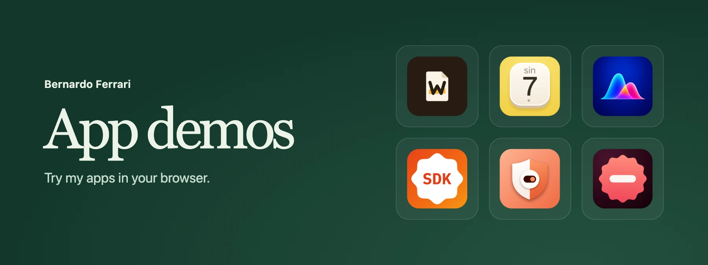
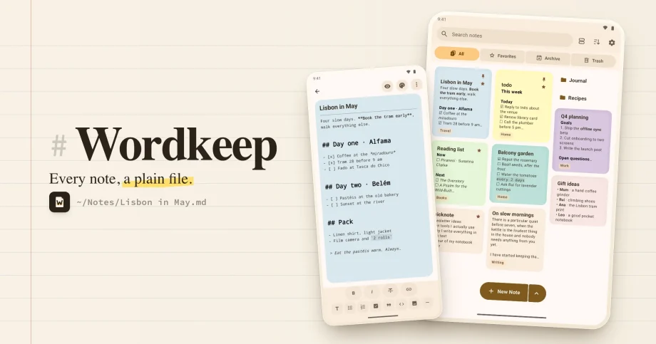
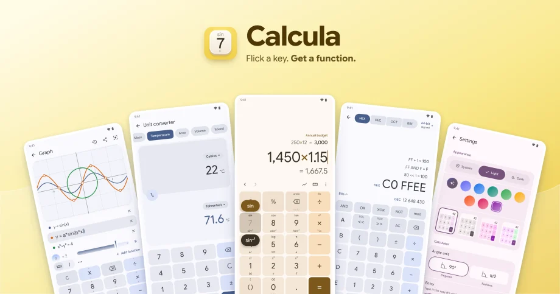
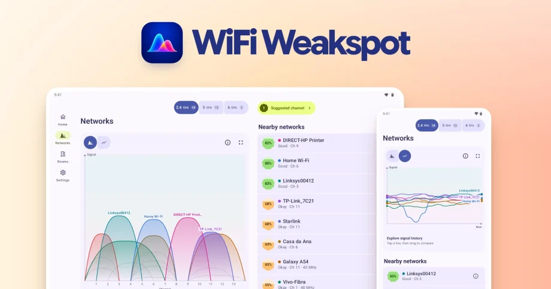
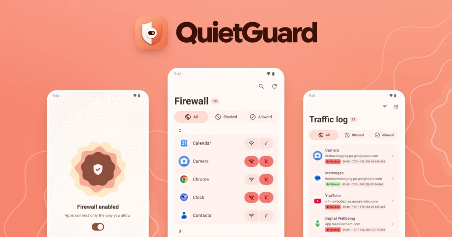
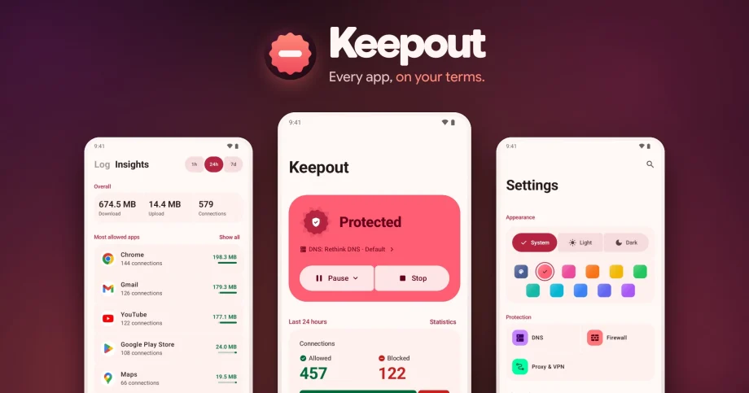
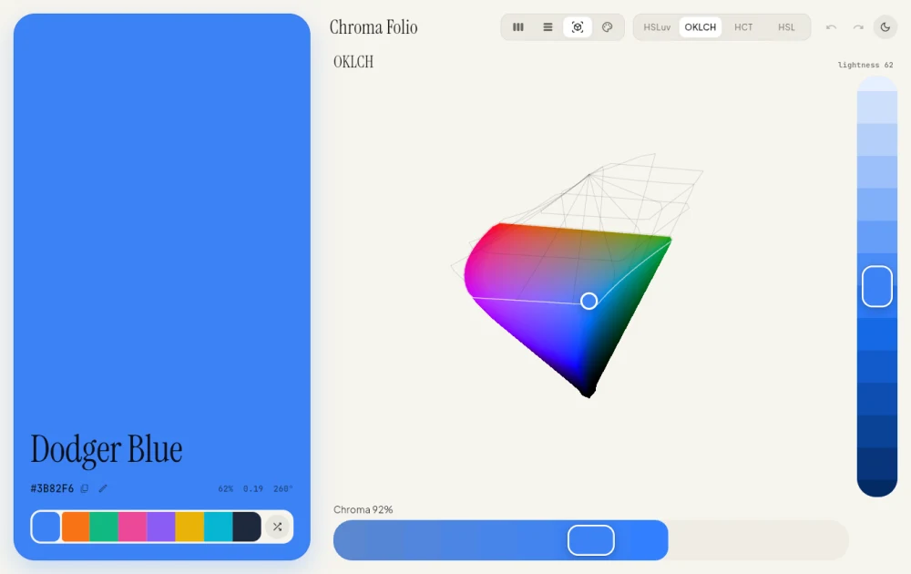
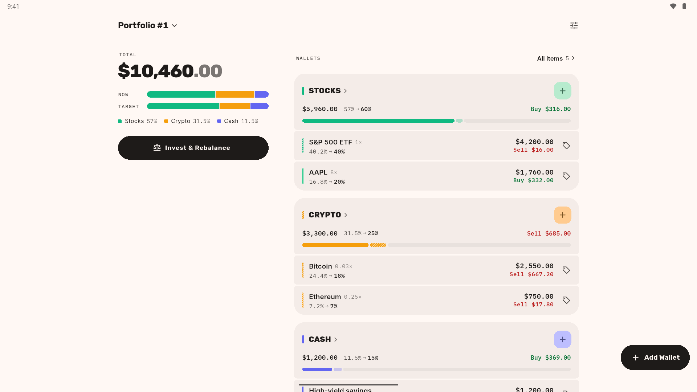

<a href="https://bernaferrari.github.io/"></a>

<p align="center">
  <a href="https://bernaferrari.github.io/"><strong>Browse the live gallery ↗</strong></a>
  &nbsp;·&nbsp;
  <a href="https://kotlin-reforge.vercel.app/">About Kotlin Reforge</a>
</p>

## Kotlin apps

Write a note or work through a calculation in the browser. Both apps run on Kotlin/Wasm and Compose Multiplatform.

Select any app screenshot to open its browser demo.

<table>
  <tr>
    <td width="50%" valign="top">
      <a href="https://bernaferrari.github.io/wordkeep/"></a>
      <h3>Wordkeep</h3>
      <p>Write and preview Markdown. Keep notes and checklists in one notebook.</p>
      <p><a href="https://bernaferrari.github.io/wordkeep/"><strong>Try Wordkeep ↗</strong></a> · <a href="https://github.com/bernaferrari/wordkeep">Source</a></p>
    </td>
    <td width="50%" valign="top">
      <a href="https://bernaferrari.github.io/calcula/"></a>
      <h3>Calcula</h3>
      <p>Flick a key for sine, plot an equation, or convert units.</p>
      <p><a href="https://bernaferrari.github.io/calcula/"><strong>Try Calcula ↗</strong></a> · <a href="https://github.com/bernaferrari/calcula">Source</a></p>
    </td>
  </tr>
</table>

### Android utilities you can try in the browser

These four demos use sample data so you can explore Android tools without device permissions.

<table>
  <tr>
    <td width="50%" valign="top">
      <a href="https://bernaferrari.github.io/wifi-weakspot/"></a>
      <h3>WiFi Weakspot</h3>
      <p>Compare 2.4, 5, and 6 GHz channels and explore a room-by-room signal map.</p>
      <p><a href="https://bernaferrari.github.io/wifi-weakspot/"><strong>Try WiFi Weakspot ↗</strong></a> · <a href="https://github.com/bernaferrari/wifi-weakspot">Source</a></p>
    </td>
    <td width="50%" valign="top">
      <a href="https://bernaferrari.github.io/sdkmonitor/"></a>
      <h3>SDK Monitor</h3>
      <p>Open an app to see its target SDK and how it changed across versions.</p>
      <p><a href="https://bernaferrari.github.io/sdkmonitor/"><strong>Try SDK Monitor ↗</strong></a> · <a href="https://github.com/bernaferrari/SDKMonitor">Source</a></p>
    </td>
  </tr>
  <tr>
    <td width="50%" valign="top">
      <a href="https://bernaferrari.github.io/quietguard/"></a>
      <h3>QuietGuard</h3>
      <p>Toggle Wi-Fi or mobile data access for an app and inspect its firewall rules.</p>
      <p><a href="https://bernaferrari.github.io/quietguard/"><strong>Try QuietGuard ↗</strong></a> · <a href="https://github.com/bernaferrari/QuietGuard">Source</a></p>
    </td>
    <td width="50%" valign="top">
      <a href="https://bernaferrari.github.io/keepout/"></a>
      <h3>Keepout</h3>
      <p>Open Activity → Insights to see which apps and domains generated traffic.</p>
      <p><a href="https://bernaferrari.github.io/keepout/"><strong>Try Keepout ↗</strong></a> · <a href="https://github.com/bernaferrari/keepout">Source</a></p>
    </td>
  </tr>
</table>

## Flutter apps

<table>
  <tr>
    <td width="50%"><a href="https://bernaferrari.github.io/tone-desk/"></a></td>
    <td width="50%" valign="middle">
      <h3>Tone Desk</h3>
      <p>Pick a seed color, tune a Material 3 theme, and preview it on sample screens in light and dark.</p>
      <p><a href="https://bernaferrari.github.io/tone-desk/"><strong>Try Tone Desk ↗</strong></a> · <a href="https://github.com/bernaferrari/tone-desk">Source</a> · <a href="https://bernaferrari.github.io/tone-desk/source-commit.txt">Deployed SHA</a></p>
    </td>
  </tr>
  <tr>
    <td width="50%"><a href="https://bernaferrari.github.io/chroma-folio/"></a></td>
    <td width="50%" valign="middle">
      <h3>Chroma Folio</h3>
      <p>Turn and slice a 3D color solid, spin color reels, and build a palette you can export.</p>
      <p><a href="https://bernaferrari.github.io/chroma-folio/"><strong>Try Chroma Folio ↗</strong></a> · <a href="https://github.com/bernaferrari/chroma-folio">Source</a> · <a href="chroma-folio/source-commit.txt">Deployed SHA</a></p>
    </td>
  </tr>
  <tr>
    <td width="50%"><a href="https://bernaferrari.github.io/CashBalancer/"></a></td>
    <td width="50%" valign="middle">
      <h3>Cash Balancer</h3>
      <p>Enter your balances and target percentages to see how much to move between assets.</p>
      <p><a href="https://bernaferrari.github.io/CashBalancer/"><strong>Try Cash Balancer ↗</strong></a> · <a href="https://github.com/bernaferrari/CashBalancer">Source</a> · <a href="CashBalancer/source-commit.txt">Deployed SHA</a></p>
    </td>
  </tr>
</table>

### More Flutter projects

- [Color Studio](https://bernaferrari.github.io/color-studio/)
- [Color Blindness Simulator](https://bernaferrari.github.io/ColorBlindnessFlutter/) · [Source](https://github.com/bernaferrari/ColorBlindnessFlutter) · [Deployed SHA](ColorBlindnessFlutter/source-commit.txt)
- [Diagonal Wipe Icon for Flutter](https://bernaferrari.github.io/diagonal-wipe-icon-flutter/)
- [Random Color Scheme](https://bernaferrari.github.io/RandomColorScheme/) · [Source](https://github.com/bernaferrari/RandomColorScheme) · [Deployed SHA](RandomColorScheme/source-commit.txt)

## More browser demos

- [Diagonal Wipe Icon for Compose](https://bernaferrari.github.io/diagonal-wipe-icon/)
- [Emoji Slider](https://bernaferrari.github.io/EmojiSlider/)
- [Vibe Jam 2025](https://bernaferrari.github.io/vibejam2025/)

<details>
<summary>Refresh the browser demos</summary>

Run the updater from this repository on macOS or Linux. Kotlin builds need a JDK and Android SDK. Set `ANDROID_HOME` to your SDK path. Flutter demos need Flutter on your PATH. Cash Balancer, Color Blindness Simulator, and Random Color Scheme build with Flutter 3.50.0. Cash Balancer also uses `curl` to fetch the Drift web files for the version in its lockfile.

```sh
python3 scripts/update-demos.py --dry-run
python3 scripts/update-demos.py
python3 scripts/update-demos.py wordkeep calcula
python3 scripts/update-demos.py chroma-folio ColorBlindnessFlutter RandomColorScheme
python3 scripts/update-demos.py CashBalancer tone-desk
```

The updater compares each app's GitHub `main` branch with the full SHA in its deployed `source-commit.txt`. It builds changed commits in temporary clones and imports each successful build with its SHA. If a build fails, the previous demo remains available and the updater exits with an error after checking the other apps.

Tone Desk deploys from its own repository. The updater verifies its live source commit and refreshes its gallery images.

Preview the changes with `python3 -m http.server 8000` and open `http://localhost:8000/`. Commit the updated demo directories and push to `main` to publish them on GitHub Pages.

Wordkeep, QuietGuard, and SDK Monitor use a service worker scoped to each demo to enable the browser isolation needed by SQLite.

</details>
