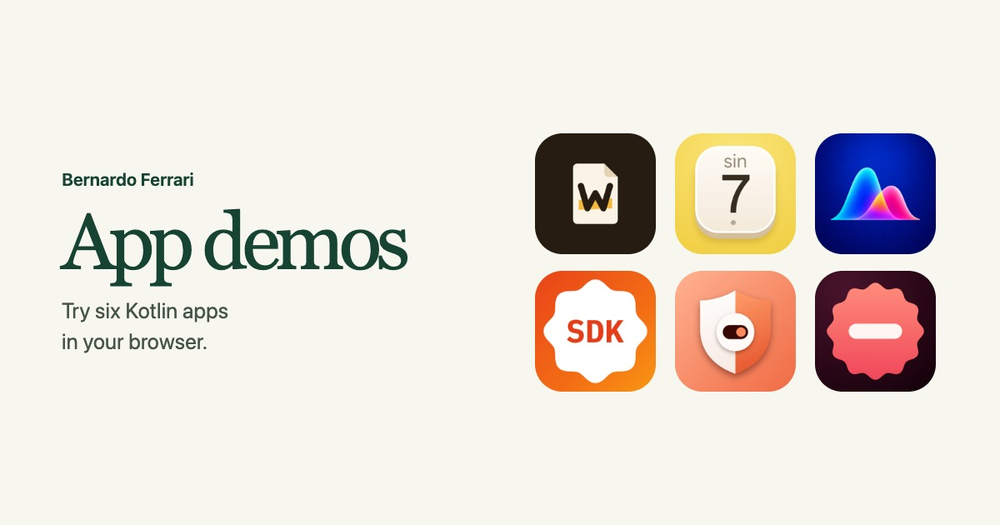
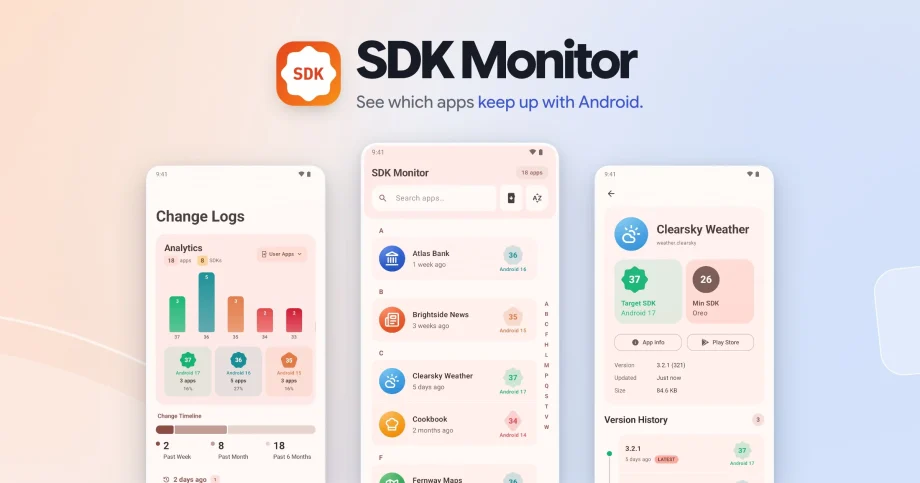
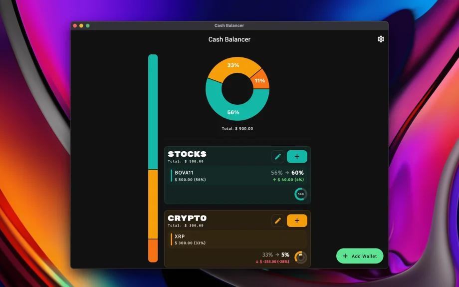

# App demos by Bernardo Ferrari

[](https://bernaferrari.github.io/)

[Browse the live gallery](https://bernaferrari.github.io/) · [Kotlin Reforge](https://kotlin-reforge.vercel.app/)

These apps run in the browser using Kotlin/Wasm and Compose Multiplatform. Wordkeep and Calcula are usable browser apps. The four Android utilities use sample data so you can explore their screens without device permissions.

## Kotlin apps

### Wordkeep

[](https://bernaferrari.github.io/wordkeep/)

Create a note and switch to the Markdown preview.

[Open Wordkeep](https://bernaferrari.github.io/wordkeep/) · [Source code](https://github.com/bernaferrari/wordkeep)

### Calcula

[](https://bernaferrari.github.io/calcula/)

Flick up on 7 for sine, or open the unit converter.

[Open Calcula](https://bernaferrari.github.io/calcula/) · [Source code](https://github.com/bernaferrari/calcula)

### WiFi Weakspot

[](https://bernaferrari.github.io/wifi-weakspot/)

Choose Allow access to enter the simulation, then open Networks and switch between the 2.4, 5, and 6 GHz channel views. The browser uses sample data.

[Open WiFi Weakspot](https://bernaferrari.github.io/wifi-weakspot/) · [Source code](https://github.com/bernaferrari/wifi-weakspot)

### SDK Monitor

[](https://bernaferrari.github.io/sdkmonitor/)

Open an app to see its target SDK and version history. The browser uses sample data.

[Open SDK Monitor](https://bernaferrari.github.io/sdkmonitor/) · [Source code](https://github.com/bernaferrari/SDKMonitor)

### QuietGuard

[](https://bernaferrari.github.io/quietguard/)

Toggle Wi-Fi access for a sample app and look through its rules. The browser uses sample data.

[Open QuietGuard](https://bernaferrari.github.io/quietguard/) · [Source code](https://github.com/bernaferrari/QuietGuard)

### Keepout

[](https://bernaferrari.github.io/keepout/)

Open Activity, then Insights, to see which apps and domains generated sample traffic. The browser uses sample data.

[Open Keepout](https://bernaferrari.github.io/keepout/) · [Source code](https://github.com/bernaferrari/keepout)

## Flutter apps

### Cash Balancer

[](https://bernaferrari.github.io/CashBalancer/)

Enter your balances and target percentages to see how much you would need to move between assets.

[Open Cash Balancer](https://bernaferrari.github.io/CashBalancer/) · [Source code](https://github.com/bernaferrari/CashBalancer)

### More Flutter projects

- [Color Studio](https://bernaferrari.github.io/color-studio/)
- [Color Blindness Simulator](https://bernaferrari.github.io/ColorBlindnessFlutter/)
- [Diagonal Wipe Icon for Flutter](https://bernaferrari.github.io/diagonal-wipe-icon-flutter/)
- [Fast Dark Theme](https://bernaferrari.github.io/fastdarktheme/)
- [HSLuv for Dart](https://bernaferrari.github.io/hsluv-dart/)
- [Random Color Scheme](https://bernaferrari.github.io/RandomColorScheme/)

## More browser demos

- [Diagonal Wipe Icon for Compose](https://bernaferrari.github.io/diagonal-wipe-icon/)
- [Emoji Slider](https://bernaferrari.github.io/EmojiSlider/)
- [Vibe Jam 2025](https://bernaferrari.github.io/vibejam2025/)

## Refresh the Kotlin demos

Run the updater from this repository on macOS or Linux. Builds use each app's Gradle wrapper and need a JDK and Android SDK. Set `ANDROID_HOME` to your SDK path.

```sh
python3 scripts/update-demos.py --dry-run
python3 scripts/update-demos.py
python3 scripts/update-demos.py wordkeep calcula
```

The updater compares each app's GitHub `main` branch with the full SHA in its deployed `source-commit.txt`. It builds changed commits in temporary clones and imports each successful build with its SHA. If a build fails, the previous demo remains available and the updater exits with an error after checking the other apps.

Preview the changes with `python3 -m http.server 8000` and open `http://localhost:8000/`. Commit the updated demo directories and push to `main` to publish them on GitHub Pages.

Wordkeep, QuietGuard, and SDK Monitor use a service worker scoped to each demo to enable the browser isolation needed by SQLite.
